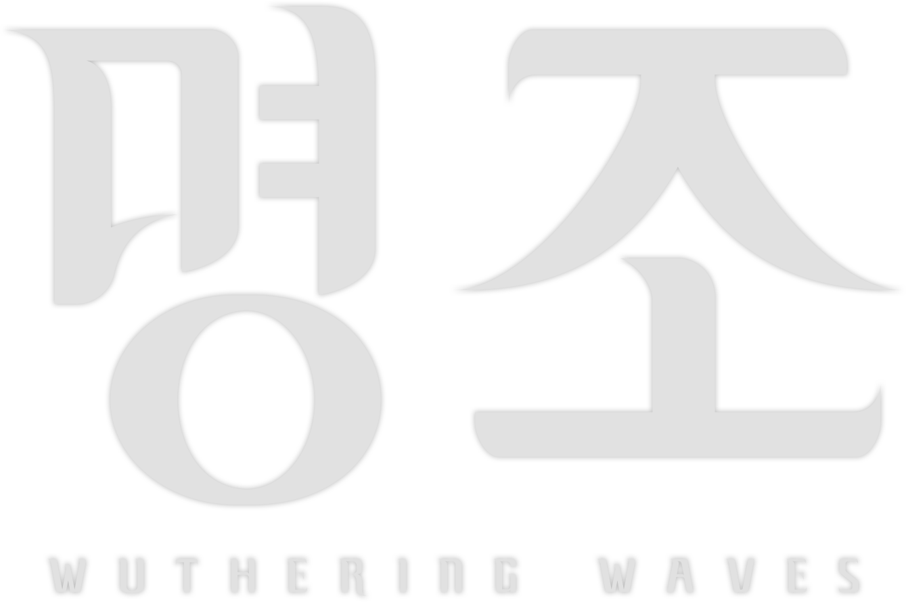

<p align="center">
  
</p>

<h3 align="center">명조: 워더링 웨이브의 공명자, 세계관, 버전 일정을 한 페이지에 모아 보여 주는 팬 사이트</h3>

<p align="center">
  2026.10.08 ~ 11.25, 개인 프로젝트
</p>

---

## 어떤 프로젝트인가요?

명조 공식 사이트는 정보가 여러 페이지에 흩어져 있어서, 지금 어떤 픽업이 진행 중인지나 어떤 공명자가 어느 진영인지 보려면 여러 번 이동해야 합니다.
이 프로젝트는 그 정보를 **스크롤 한 번으로 볼 수 있는 한 페이지**로 모아 본 포트폴리오입니다.

화면 배치는 명일방주: 엔드필드 공식 사이트처럼 **왼쪽 사이드바 + 섹션별 전체 화면**으로 잡고, 색과 글꼴은 명조 사이트처럼 **검정 바탕 + 골드 라인, 명조체 제목**으로 맞췄습니다.

> [!NOTE]
> 이미지와 게임 자료는 명조 공식 사이트에서 가져온 것으로, 개인 포트폴리오 용도로만 사용합니다.

---

## 기술 스택

| 구분 | 사용한 기술 |
| --- | --- |
| **언어** |    |
| **프론트엔드** |   |
| **DB** |   |
| **배포** |   |
| **AI 도구** |  |

AI 도구는 구조를 설계하고 코드를 작성하고 리뷰할 때, 문서를 정리할 때 함께 사용했습니다.

---

## 구조 흐름

<p align="center">
  <b>브라우저</b> &nbsp;➜&nbsp; <b>Cloudflare Workers</b> (Next.js 서버 컴포넌트) &nbsp;➜&nbsp; <b>Hyperdrive</b> &nbsp;➜&nbsp; <b>DB</b> (Neon)
</p>

페이지를 요청하면 서버 컴포넌트가 DB에서 공명자, 일정, 공지 등을 **한 번에 동시에 조회**(`Promise.all`)해서 HTML로 만들어 보냅니다.
- 배포 환경: Workers ➜ Hyperdrive(연결 풀) ➜ Neon
- 로컬 개발: `.env`의 `DATABASE_URL`로 Neon에 바로 연결

사이드바 섹션 목록처럼 화면 구조에 해당하는 값은 DB가 아니라 코드(`src/lib/data.ts`)에 두었습니다.

---

## 화면과 주요 기능

왼쪽 사이드바에서 섹션을 고르면 그 위치로 이동하고, 스크롤하면 지금 보고 있는 섹션이 사이드바에 표시됩니다. 섹션이 화면에 들어올 때 내용이 나타나는 효과도 넣었습니다.

| 섹션 | 내용 |
| --- | --- |
| **홈** | 메인 비주얼과 플랫폼(Windows, App Store, Google Play, PS5) 안내 |
| **공명자** | 진영(황룡, 검은 해안 …)별로 공명자를 나누고, 고르면 일러스트·속성·등급·소개를 보여 줌 |
| **세계관** | 황룡, 검은 해안, 리나시타, 라하이 로이 4개 지역의 공식 설명과 주요 장소 38곳 (장소를 고르면 설명을 보여 줌) |
| **버전 일정** | 업데이트, 픽업, 이벤트, 특별 방송, 콜라보를 줄별로 나눈 **배너 캘린더** |
| **콘텐츠 소개** | 게임 콘텐츠 슬라이드 |
| **에코 시스템** | 에코 관련 세계관 용어 카드 |
| **공지** | 공지 목록 (최신순) |
| **게임 정보** | 장르, 플랫폼 등 기본 정보 카드 |

### 버전 일정 캘린더

> [!TIP]
> 일정 데이터만 넣으면 **가장 이른 시작일이 든 주의 월요일부터 가장 늦은 종료일이 든 주의 일요일까지** 표시 범위를 자동으로 계산합니다. 하루짜리 일정은 시작일과 종료일을 같게 넣으면 됩니다.

### 만들면서 바꾼 것들

- 처음에는 JSX 파일 몇 개에 화면과 데이터가 섞여 있었는데, `components/sections`, `components/common`, `hooks`, `lib` 구조로 나누고 TypeScript로 옮겼습니다.
- 텍스트 데이터를 코드에 직접 넣어 두다가, Neon DB 테이블로 옮기고 서버에서 읽어 오도록 바꿨습니다.
- 버전 일정을 단순 목록에서 엔드필드식 배너 캘린더로 바꿨습니다.
- 공명자 목록, 에코 카드, 아이콘을 공식 자료 기준으로 다시 정리했습니다.

---

## 디자인

명조 공식 사이트의 색을 기준으로 토큰을 만들었습니다. (`src/styles/variables.css`)

- 골드 `#C4AC7D`: 제목, 강조, 선택된 상태
- 밝은 골드 `#DAB67D`: 마우스를 올렸을 때
- 골드 라인 `#5F5642`: 구분선, 테두리
- 배경 `#0A0A0B`, 패널 `#141416`: 바탕과 카드
- 본문 `#E1E1E1`, 보조 `#929292`: 글씨

영문 제목은 가로로 넓은 글꼴, 한글 제목은 명조체로 나눠서 공식 사이트 느낌을 살렸습니다.

---

## 폴더 구조

```
react/basic/ppo/
├─ db/                  schema.sql(테이블), seed.sql(초기 데이터), setup.mjs(DB 초기화)
├─ public/images/       공명자, 일정 배너, 세계관 이미지
└─ src/
   ├─ app/              레이아웃, 첫 페이지, error.tsx(DB 오류 안내)
   ├─ components/
   │  ├─ sections/      홈, 공명자, 세계관, 일정, 콘텐츠, 에코, 공지, 게임 정보
   │  └─ common/        슬라이더, 이전·다음 버튼, 이미지, 섹션 제목 등 공통 부품
   ├─ hooks/            useActiveSection(현재 섹션), useReveal(등장 효과), useCycle(넘기기)
   ├─ lib/              data.ts(섹션 목록), format.ts, db/(DB 연결, 조회)
   ├─ styles/           전역, 변수, 사이드바, 섹션, 반응형 CSS
   └─ types/            공용 타입
```

---

## 실행 방법

```bash
cd react/basic/ppo
npm install

# .env 에 Neon 연결 문자열 넣기
# DATABASE_URL=postgres://...

npm run db:setup   # 테이블 생성 + 초기 데이터 (기존 데이터는 지워짐)
npm run dev        # http://localhost:3000
npm run build
npm run deploy     # Cloudflare Workers 배포
npm run lint
```

> [!WARNING]
> `npm run db:setup`은 테이블을 지우고 다시 만듭니다. DB 내용이 초기 데이터로 돌아가니 주의하세요.

---

## 개발 과정

| 날짜 | 한 일 |
| --- | --- |
| 10.08 | 저장소 생성 |
| 10.12 | DB 테이블 기본 틀 |
| 10.13 | 이미지 에셋 정리 |
| 10.14 | 서버 기본 구축 |
| 10.26 | 아이콘 작업 |
| 11.25 | 명조 메인 페이지를 엔드필드 스타일로 구현, 폴더 구조 정리와 TypeScript 전환 |
| 11.25 | 버전 일정 배너 캘린더, 공명자·에코 카드 개편 |
| 11.25 | Neon DB 연결, Cloudflare Workers 배포 |

### 회고

- **화면 구조와 데이터는 처음부터 나눠 두자.** 데이터를 컴포넌트 안에 넣어 두니 나중에 DB로 옮길 때 고칠 곳이 많았습니다.
- **.env 파일은 커밋하지 않는다.** DB 연결 문자열은 `.env`에만 두고, 배포 환경은 Hyperdrive 설정으로 연결했습니다.

### 아쉬운 점과 다음에 할 것

- 일정과 공지를 지금은 `seed.sql`로 직접 넣고 있어서, 관리자 화면에서 추가하고 수정할 수 있게 하고 싶습니다.
- 모바일에서 사이드바와 캘린더를 더 보기 좋게 다듬고 싶습니다.
